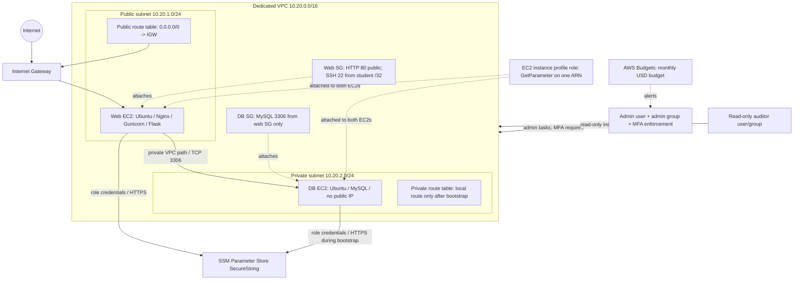

# Secure AWS Cloud Deployment — Complete Study and Execution Guide

This single-file guide is bundled with the runnable starter repository. It explains the learning objective, build order, key shell and AWS CLI syntax, network/security design, identity separation, secret flow, budget alerts, validation, troubleshooting and teardown.

## Read this before running commands

- This is a **real AWS lab**, not a simulation. Creating resources can incur charges. The temporary NAT Gateway is intentionally created only during provisioning and must be removed after the end-to-end database check succeeds.
- Use a dedicated learning account and the dedicated VPC created by this project. Do not run the destructive teardown against a shared VPC.
- Use AWS CLI v2 with approved temporary operator credentials; do not create hard-coded AWS access keys. Replace all email, owner, CIDR and repository placeholders before execution.
- The scripts do not automatically create console passwords or MFA seeds. An account administrator must securely enable console access for the human IAM users, and the administrator must enroll MFA.
- Capture sanitized evidence before teardown. Never capture secret values, private keys, decrypted SSM output, password-bearing environment files, recovery codes or MFA QR seeds.
- AWS Budgets sends alerts but is **not** a spending cap. Verification of an email recipient and proof of an actual threshold notification are different things; forecasted alerts can require adequate billing history.

## Execution order

1. Configure `REGION`, `OWNER`, `STUDENT_CIDR` and `BUDGET_EMAIL` in the same Bash session.
2. Create the monthly budget and verify the alert email recipient.
3. Publish the repository contents to an empty public GitHub repository with a `main` branch; run `scripts/secret_scan.sh`.
4. Execute `infra/01-network.sh`, then `infra/02-security.sh`.
5. Configure human console access/MFA outside scripts, using the IAM Console.
6. Set `REPO_URL` to the public GitHub URL and run `infra/03-compute.sh`.
7. Capture architecture, IAM, secret scan, budget, network and runtime evidence.
8. Run `teardown.sh` when finished and verify all project-owned billable resources are removed.

## Files included

- [Step-by-step deployment and syntax reference](docs/STEP-BY-STEP.md)
- [Architecture](docs/ARCHITECTURE.md)
- [IAM design](docs/IAM-DESIGN.md)
- [Cost governance and teardown proof](docs/COST-GOVERNANCE.md)
- [Failure runbook](docs/RUNBOOK.md)
- [Evidence checklist](docs/evidence/README.md)

---

# Step-by-step deployment and syntax reference

## 0. Scope and safety

This lab creates real resources in AWS. It is intended for a dedicated learning account and a dedicated VPC created by `infra/01-network.sh`. It is not a production architecture. Do not run these destructive scripts against a shared VPC or a repository containing real credentials.

The sample stack is IPv4-only and single-AZ to reduce cost and concepts. It uses Ubuntu 24.04, Nginx, Gunicorn, Flask, MySQL, Parameter Store and an IAM instance profile. All commands are written for Bash and AWS CLI v2. Install `aws`, `jq`, `openssl`, `git`, `curl`, `sed` and `bash` on your workstation before beginning.

Prefer temporary operator credentials (for example, AWS IAM Identity Center) rather than long-lived access keys. AWS recommends temporary credentials for human users and workloads, MFA and least privilege; see [IAM security best practices](https://docs.aws.amazon.com/IAM/latest/UserGuide/best-practices.html).

## 1. Understand the intended network

```text
Internet
   |
Internet Gateway
   |
Public subnet 10.20.1.0/24 ── web EC2 (public IP, Nginx/Gunicorn)
                                   |
                         TCP/3306 from web SG only
                                   |
Private subnet 10.20.2.0/24 ─ database EC2 (private IP only)

During database bootstrap only:
private route 0.0.0.0/0 -> temporary NAT Gateway -> IGW
After successful /db test:
remove that default route, delete NAT Gateway and release its Elastic IP
```

The VPC `10.20.0.0/16` has a local route for internal VPC communication. The public route table has `0.0.0.0/0` to the IGW; the private route table has no permanent default internet route. A private IP can communicate inside the VPC without a NAT Gateway. The NAT is temporary only because the database boot script needs internet access to install packages and call SSM Parameter Store.

## 2. Configure the local operator environment

Run in one Bash terminal so environment variables remain available:

```bash
export REGION="us-east-1"
export OWNER="student01"
export STUDENT_CIDR="YOUR_CURRENT_PUBLIC_IPV4/32"
export BUDGET_EMAIL="your-real-inbox@example.com"
aws --version
aws sts get-caller-identity
```

Replace the example owner, email and CIDR. `STUDENT_CIDR` must be your current public IPv4 address followed by `/32`; `/32` represents one IPv4 address. The security script validates the suffix and AWS validates the CIDR. The `sts get-caller-identity` call confirms which AWS account the CLI will operate in; compare the account with the one intended for the lab.

### Bash syntax used throughout

- `#!/usr/bin/env bash`: asks the environment to find Bash and run the file with it.
- `set -Eeuo pipefail`: `-e` exits on many unhandled command failures, `-E` propagates the `ERR` trap through more contexts, `-u` treats unset variables as errors, and `pipefail` makes a pipeline fail if a command inside it fails.
- `"${VAR:-default}"`: uses `VAR` when set/non-empty, otherwise a default. `"${VAR:?message}"` stops with a message if `VAR` is missing or empty.
- `$(command)`: captures command output into a variable. Example: `ACCOUNT_ID="$(aws sts get-caller-identity --query Account --output text)"`.
- `[[ condition ]]`: Bash conditional test; `=~` performs a regular-expression match.
- `if ...; then ...; fi`: conditionally runs the body. `! command` negates the command's exit status.
- `for item in ...; do ...; done`: repeats a block for each word/item.
- `array=(...)` and `"${array[@]}"`: store multiple command arguments without flattening their spacing.
- `\` at end of line: continues the same command on the next line. Do not place a trailing space after the backslash.
- `> file`: writes standard output to a file, overwriting it. `>> file` appends. `2>&1` redirects standard error to the current standard-output destination. `/dev/null` discards output.
- `trap '...' ERR`: runs a handler when Bash detects an error in covered contexts; `LINENO` is used in the scripts to report where failure occurred. The secret is intentionally never printed in the handler.
- `umask 077`: makes newly created files private to their owner by default. `chmod 600 file` gives the owner read/write permission and removes permissions from group/others; `chmod 400 key.pem` makes the private key owner-read-only.
- `source file`: loads variable assignments from a local file into the current shell. Only source the generated `infra/.state` file produced by your own scripts; sourcing arbitrary input executes shell syntax.
- `file://path`: tells the AWS CLI to read a JSON policy/user-data/input from a local file; it is not a secret manager.

## 3. Create the budget before infrastructure

Run:

```bash
./budget/create-budget.sh
```

The script derives the account ID from `sts get-caller-identity`, reads `budget/budget.json`, replaces the email placeholder in a temporary JSON file, then calls `aws budgets create-budget`. It marks the budget with `Project=webstack` and `Owner=$OWNER` tags.

### What the budget JSON means

- `BudgetName`: unique name for this budget in the account.
- `BudgetLimit.Amount` and `Unit`: monthly alert threshold, template `$10 USD`.
- `TimeUnit: MONTHLY`: monthly period.
- `BudgetType: COST`: spend budget rather than usage or reservation coverage.
- `CostTypes`: tells Budgets which billing items to include/exclude; the template includes tax, credits, refunds, subscriptions and common cost types. Review the official fields when adapting the budget.
- `notifications.json` has two entries: `NotificationType=ACTUAL`, `Threshold=80`, `ThresholdType=PERCENTAGE`; and `NotificationType=FORECASTED`, `Threshold=100`, `ThresholdType=PERCENTAGE`. `ComparisonOperator=GREATER_THAN` means alert when the threshold is exceeded.
- `Subscribers` uses `SubscriptionType=EMAIL` and an address. The committed email is a placeholder; the real address is supplied from the shell and is not written to the repository.

AWS requires the recipient to verify their email before actual budget notifications are delivered. Open the verification email, follow its link while signed into the AWS account, then check the Budget page for an active/verified recipient. A verification message proves address validation, not that the 80% or forecast threshold actually fired. Budgets update on a delay; forecasts may require enough historical cost data (AWS documents about five weeks for forecast data in some budget guidance). Don't expect an immediate threshold alert simply because the budget exists. See [email recipient verification](https://docs.aws.amazon.com/cost-management/latest/userguide/budgets-email-recipients.html) and [Budgets best practices](https://docs.aws.amazon.com/cost-management/latest/userguide/budgets-best-practices.html).

Verify the configuration:

```bash
ACCOUNT_ID="$(aws sts get-caller-identity --query Account --output text)"
aws budgets describe-budget --region us-east-1 --account-id "$ACCOUNT_ID" --budget-name webstack-monthly-budget
aws budgets describe-notifications-for-budget --region us-east-1 --account-id "$ACCOUNT_ID" --budget-name webstack-monthly-budget
```

Budgets are account-level spend notifications, not a hard spending limit. A charge can occur before an alert arrives because cost data and notifications lag.

## 4. Build the network — `infra/01-network.sh`

Run:

```bash
./infra/01-network.sh
```

The script creates a dedicated VPC, enables DNS hostnames/support, creates two `/24` subnets in one available Availability Zone, creates/attaches an IGW, and creates public/private route tables. Only the public route table receives a default route. It also tags the VPC-generated default route table, default security group and default network ACL. Created IDs are saved in `infra/.state`, which is private and Git-ignored.

### Key AWS CLI options in this script

- `aws ec2 create-vpc --cidr-block 10.20.0.0/16`: creates an isolated IPv4 network. A CIDR is an address range in slash notation.
- `--tag-specifications "ResourceType=vpc,Tags=[...]"`: applies tags at creation. The syntax is AWS CLI shorthand: resource type followed by a list of `{Key=...,Value=...}` objects.
- `--query 'Vpc.VpcId'`: JMESPath extracts one field from the AWS response, so the variable stores only the ID.
- `--output text`: returns a text value that is easy to capture in Bash; `table` is for human display and `json` for structured output.
- `--enable-dns-support '{"Value":true}'` and `--enable-dns-hostnames`: enable DNS features required by many VPC workloads.
- `--cidr-block 10.20.1.0/24` / `10.20.2.0/24`: creates public/private IP ranges inside the `10.20.0.0/16` VPC without overlap.
- `--availability-zone "$AZ"`: keeps the training environment in one AZ to keep the topology simple; production availability designs generally use more than one AZ.
- `modify-subnet-attribute --map-public-ip-on-launch`: configures automatic public IPv4 assignment for instances launched in the public subnet. The compute script also explicitly requests a public IP for the web host.
- `create-internet-gateway` / `attach-internet-gateway`: creates and attaches the VPC's internet gateway. The IGW alone doesn't make a subnet public; a route table must point to it and an instance needs public addressing/security-group rules.
- `create-route-table`, `create-route --destination-cidr-block 0.0.0.0/0 --gateway-id "$IGW_ID"`: creates a table and a default IPv4 route through the IGW. `0.0.0.0/0` means any IPv4 destination not matched by a more-specific route.
- `associate-route-table`: associates a subnet with a route table. The script records the association ID for audit/cleanup.
- `describe-* --filters "Name=vpc-id,Values=$VPC_ID"`: narrows a list response to resources belonging to the project VPC. `--query` projects only columns needed for inspection.

The private route table intentionally has no default internet route yet. The state file contains IDs, not secret values. Do not commit it because it contains live infrastructure identifiers.

## 5. Create security and identities — `infra/02-security.sh`

Set `STUDENT_CIDR` in the same terminal and run:

```bash
export STUDENT_CIDR="YOUR_CURRENT_PUBLIC_IPV4/32"
./infra/02-security.sh
```

### Security-group rules

- Web SG inbound `TCP/80` from `0.0.0.0/0`: public HTTP only.
- Web SG inbound `TCP/22` from `STUDENT_CIDR`: SSH from one student IPv4 only. This is a temporary lab access method; keep the CIDR current. Do not use `0.0.0.0/0` for SSH.
- DB SG inbound `TCP/3306` with `--source-group "$WEB_SG"`: MySQL is permitted only from interfaces associated with the web SG. It is more resilient than allowing an IP range when web IPs change.
- No inbound port 3306 from the internet; DB instance launch uses `--no-associate-public-ip-address` in the private subnet.
- Security groups are stateful: reply traffic for permitted connections is automatically allowed. Default outbound rules allow package/API traffic for this lab; tighten them further in a production environment after enumerating needed egress.

### Why three identities

1. `webstack-admin` is a human IAM user in `webstack-admins`. The group receives `AdministratorAccess` plus a customer-managed deny policy that blocks normal actions when MFA is absent but permits MFA enrollment actions. The script does not create a console password or access keys. After `infra/02-security.sh`, an account administrator opens **IAM Console → Users → webstack-admin → Security credentials**, enables console access/creates an initial password securely, and shares it only through the approved password-delivery process. Repeat console-access setup for `webstack-auditor` if you need to demonstrate read-only login. Sign in as `webstack-admin`, use **Security credentials → Assign MFA device** to enroll an authenticator, and confirm its state is enabled. Test normal administrative actions only with an MFA-authenticated session. Never put a password or MFA seed in a script or commit it to the repository.
2. `webstack-auditor` is in `webstack-auditors`, which receives AWS managed `ReadOnlyAccess` plus an explicit deny policy blocking `ssm:GetParameter*`. It can inspect resources but cannot retrieve parameter values, including through history/path APIs. The managed policy is broad account-wide read-only access; use a narrower custom policy for a real enterprise audit role.
3. `webstack-ec2-role` is trusted only by the EC2 service through `iam/trust-policy.json`. Its one attached custom policy allows `ssm:GetParameter` on exactly `arn:aws:ssm:REGION:ACCOUNT_ID:parameter/webstack/db-password` (the script fills in the selected region and account ID at runtime). It does not grant `PutParameter`, other SSM reads, administrator access or Session Manager features.

The template policy contains `123456789012` and `us-east-1` as **placeholders/default template values only**. The script replaces them with the caller's account ID and selected `REGION` in a private temporary file before creating the policy. No actual account ID is committed. Parameter Store uses `SecureString`; the password is generated with `openssl rand -hex 24`, written through a mode-600 temporary JSON document, and never printed or saved in `.state`.

### Relevant IAM/SSM syntax

- `Principal.Service = ec2.amazonaws.com` in the trust policy means EC2 can assume the role. A trust policy answers **who can assume** a role; a permissions policy answers **what the assumed role can do**.
- `Action: ssm:GetParameter` plus one `Resource` ARN follows least privilege: the workload can retrieve exactly one parameter.
- `aws sts get-caller-identity --query Account --output text` discovers the account ID for ARN construction; it avoids hard-coding the real ID.
- `create-policy --policy-document file://...` creates a managed customer policy; `attach-role-policy` attaches it to the EC2 role. `create-instance-profile` and `add-role-to-instance-profile` make the role attachable to EC2.
- `put-parameter` with `Type: SecureString` asks SSM Parameter Store to store an encrypted string. `GetParameter --with-decryption` returns a decrypted value only to a principal allowed to retrieve it.
- The user/group script makes identities and policy groups but does not add long-lived access keys. Do not call `aws iam create-access-key` for these users.

## 6. Prepare and scan the repository

The web user-data script clones a public GitHub repo's `main` branch. Therefore the repository must contain these exact files before the EC2 launch:

```text
app/app.py
app/requirements.txt
deploy/systemd/webstack.service
deploy/nginx/webstack.conf
deploy/db-userdata.sh
deploy/web-userdata.sh
```

Create an **empty public GitHub repository** (do not ask GitHub to generate a README/license because this folder already contains them), then from the root of this folder run:

```bash
git init -b main
./scripts/secret_scan.sh
git add .gitignore README.md infra iam budget app deploy scripts docs teardown.sh
git status --short
git commit -m "Add secure AWS deployment lab"
git remote add origin "https://github.com/YOUR_GITHUB_OWNER/YOUR_PUBLIC_REPO.git"
git push -u origin main
```

Replace both GitHub placeholders before running `git remote add`. Authenticate using your approved GitHub sign-in; do not embed a GitHub token in the remote URL. If a remote already exists, inspect `git remote -v` rather than adding a second `origin`.

The web user-data script clones the public repo's `main` branch, so every file needed by bootstrap must be committed and pushed **before** launching the EC2 instances. Run the scan again after edits and before commits:

```bash
./scripts/secret_scan.sh
git status --short
```

The scanner checks common high-confidence AWS access-key/private-key patterns and disallowed local files. A scanner is a guardrail, not proof that the repository is secret-free. Inspect diffs manually, review Git history, and rotate any credential that was ever committed—removing it from the latest commit alone does not make it safe.

`.gitignore` blocks `*.pem`, rendered user data, `.env` files and `infra/.state`. Git ignores only prevent new untracked files being added; they do not remove files already tracked. Check with `git ls-files` if you previously committed a key.

## 7. Launch database then web — `infra/03-compute.sh`

Set the actual public HTTPS repo URL and run:

```bash
export REPO_URL="https://github.com/YOUR_GITHUB_OWNER/YOUR_PUBLIC_REPO.git"
./infra/03-compute.sh
```

The script does the following in order:

1. Resolves the current Ubuntu 24.04 AMD64 AMI using a public SSM parameter.
2. Creates a tagged EC2 key pair. AWS returns the private half only once; the script writes it to `~/.ssh/webstack-key.pem` under a restrictive umask and changes permission to `400`. Do not commit this file.
3. Allocates a tagged Elastic IP and creates a tagged NAT Gateway in the public subnet.
4. Waits for NAT availability, then temporarily adds `0.0.0.0/0` via NAT to the private route table.
5. Renders `db-userdata.sh` with the selected region and launches the database in the private subnet **without a public IPv4 address**.
6. Waits for EC2 state and status checks, then captures the private IP.
7. Renders web user data with region, database private IP and repository URL, launches the web instance with a public IPv4 address, and waits for status checks.
8. Polls `http://WEB_PUBLIC_IP/db`. This is an end-to-end gate: it should return JSON containing `database=connected`, proving the app can authenticate and execute a query against MySQL through the private path.
9. Only after that check succeeds, the script deletes the temporary private default route, deletes the NAT Gateway, waits for deletion, and releases the temporary Elastic IP. If the readiness check fails, it intentionally leaves the NAT route/Gateway for diagnosis and prints a warning. You must explicitly clean it up later.

### Meaning of the key `run-instances` options

- `--region "$REGION"`: selects the AWS Region for the API request.
- `--image-id "$AMI_ID"`: chooses the Ubuntu 24.04 AMI. The AMI parameter is resolved at runtime, so no region-specific AMI ID is hard-coded.
- `--instance-type t3.micro`: chooses a small burstable instance. Size and eligibility/cost depend on your account/region; check pricing and quotas before use.
- `--count 1`: request one instance.
- `--key-name webstack-key`: associates the EC2 key pair for SSH. The DB has no public IP and its SG has no inbound SSH rule by default; the key is primarily useful for the public web host and an approved temporary diagnostic path.
- `--subnet-id "$PRIV_SUBNET"` / `--subnet-id "$PUB_SUBNET"`: chooses the correct subnet. The subnet and security groups must belong to the same VPC.
- `--security-group-ids "$DB_SG"` / `"$WEB_SG"`: applies the tier's firewall policy. These are shell-variable expansions, not literal strings.
- `--no-associate-public-ip-address`: prevents automatic public IPv4 assignment to DB. `--associate-public-ip-address` requests a public IPv4 address for the web server.
- `--iam-instance-profile "Name=$INSTANCE_PROFILE"`: supplies temporary role credentials through instance metadata; it avoids static AWS keys in user-data.
- `--metadata-options 'HttpTokens=required,HttpEndpoint=enabled,HttpPutResponseHopLimit=1'`: requires IMDSv2 tokens and enables the metadata endpoint with hop limit one.
- `--user-data file://...`: passes a shell script to cloud-init. User-data scripts generally run at first boot as root; they are not a secret store. Never put credentials in the script.
- `--tag-specifications`: applies `Project`, `Owner` and `Name` tags at creation. The compute script tags instance, EBS volume and primary network interface resources.
- `--query 'Instances[0].InstanceId' --output text`: extracts the new instance ID without dumping the full response.
- `aws ec2 wait instance-running` / `instance-status-ok`: CLI waiters poll AWS until instance state or status checks meet the waiter's success condition. They do **not** guarantee that user-data is finished, so the final `/db` poll is still necessary.
- `sed -e 's|__DB_PRIVATE_IP__|...|g'`: substitutes a non-secret deployment value into a template. Rendered scripts are ignored by Git; inspect them before use and delete them at teardown.
- `curl -fsS --max-time 6 URL`: fails on HTTP error responses (`-f`), stays quiet except errors (`-sS`), and times out a single attempt after six seconds. The loop retries because cloud-init may still be working.

### Additional AWS CLI flag reference

The scripts use the same command-line conventions repeatedly. The following reference covers the meaningful flags that appear across the networking, security, launch, budget and teardown scripts.

| Flag or syntax | Meaning in this lab |
|---|---|
| `--region "$REGION"` | Selects the Region for a regional service call. IAM is global; Budgets commands in this template use `us-east-1`. |
| `--vpc-id "$VPC_ID"` | Tells AWS which VPC owns a subnet, route table, security group, or gateway. Related resources must be in compatible VPCs. |
| `--subnet-id "$PUB_SUBNET"` / `"$PRIV_SUBNET"` | Selects where the EC2 instance or NAT Gateway is placed. The database uses the private subnet; the web instance and NAT Gateway use the public subnet. |
| `--route-table-id "$PRIV_RT"` | Identifies the route table whose default route is temporarily changed during DB provisioning. |
| `--destination-cidr-block 0.0.0.0/0` | Defines the IPv4 default route: destinations not covered by a more-specific route. It is not an inbound firewall rule. |
| `--gateway-id "$IGW_ID"` | Makes the public route target the Internet Gateway. |
| `--nat-gateway-id "$NAT_ID"` | Makes the temporary private default route target the NAT Gateway. |
| `--protocol tcp --port 3306 --source-group "$WEB_SG"` | Allows MySQL TCP connections from ENIs attached to the web security group; no world-open database port. |
| `--protocol tcp --port 80 --cidr 0.0.0.0/0` | Allows HTTP from any IPv4 address, satisfying the project's public HTTP rule. |
| `--protocol tcp --port 22 --cidr "$STUDENT_CIDR"` | Allows SSH only from the student's IPv4 `/32`. Never replace this with `0.0.0.0/0`. |
| `--tag-specifications "ResourceType=...,Tags=[...]"` | Applies tags as a resource is created. The command uses AWS CLI shorthand syntax; commas separate fields and braces represent each tag object. |
| `--tags "Key=Project,Value=webstack" "Key=Owner,Value=$OWNER"` | Applies tags through IAM APIs that use a `--tags` list rather than EC2 tag specifications. |
| `--filters "Name=vpc-id,Values=$VPC_ID"` | Server-side filtering narrows a describe/list response before it is returned. Multiple filters are usually combined with AND; multiple values for one filter are alternatives. |
| `--query 'Instances[0].InstanceId'` | Uses JMESPath to extract only the field needed from the JSON response. Array index `[0]` selects the first result. |
| `--output text` / `json` / `table` | `text` is useful for shell variables, `json` for structured inspection or further processing, and `table` for human-readable terminal output. Don't parse a decorative table in scripts. |
| `--iam-instance-profile "Name=$INSTANCE_PROFILE"` | Attaches an IAM instance profile to EC2 so workloads receive temporary role credentials from instance metadata, not static AWS keys. |
| `--metadata-options 'HttpTokens=required,HttpEndpoint=enabled,HttpPutResponseHopLimit=1'` | Requires IMDSv2 tokens and limits metadata response hops to one, a defensive default for this single-host lab. |
| `--user-data "file://path/to/script.sh"` | Sends the local file contents as EC2 user data; cloud-init runs it during first boot. `file://` is a local-file reference, not a URL or a secret vault. |
| `--no-associate-public-ip-address` | Explicitly prevents the DB instance from receiving an auto-assigned public IPv4 address at launch. |
| `--key-name webstack-key` | Associates the EC2 public key. AWS returns the corresponding private key material only when the key pair is created; the script stores it locally with restrictive permissions. |
| `--policy-document "file://...json"` | Supplies an IAM permissions policy document to create-policy. |
| `--assume-role-policy-document "file://...json"` | Supplies the role trust policy: who is allowed to assume the role. It does not itself grant SSM permissions. |
| `--policy-arn "$READ_POLICY_ARN"` | Identifies a customer- or AWS-managed IAM policy for attachment/detachment. |
| `--name "/webstack/db-password" --with-decryption` | `--name` picks the exact parameter; `--with-decryption` asks Parameter Store to return the plaintext value to the authorized process. Never display or log the result. |
| `--account-id "$ACCOUNT_ID" --budget file://budget.json` | Identifies the billing account and supplies the budget configuration file to AWS Budgets. |
| `--notifications-with-subscribers file://...json` | Defines the alert thresholds and email subscribers. Email recipients must complete AWS verification. |
| `--resource-tags "Key=Project,Value=webstack" ...` | Tags the budget itself; budget tags use a different CLI option than EC2 resources. |
| `aws ec2 wait ...` | Uses an AWS CLI waiter to poll until a named resource state is reached. `instance-running` alone does not mean user data has finished; the later HTTP readiness loop is required. |
| `aws ec2 delete-*`, `aws iam delete-*`, `aws ssm delete-parameter` | Destructive operations. The teardown script requires an explicit confirmation token and uses saved IDs; inspect every deletion before running in a non-lab account. |

### Common shell patterns used by the scripts

```bash
VALUE="$(command --query 'Field' --output text)"
```

`$(...)` runs the command in a subshell and captures stdout; quoting the substitution preserves a single value as one argument. If the command's output can include secrets, don't print the resulting variable.

```bash
if ! command; then
  echo "operation failed" >&2
  exit 1
fi
```

`!` reverses the exit status for the `if`; `>&2` sends the message to standard error; `exit 1` returns a non-zero script status to the caller.

```bash
for ID in $IDS; do
  command --resource-id "$ID"
done
```

This iterates over a whitespace-separated list of IDs from AWS CLI `--output text`. IDs themselves contain no whitespace. When handling arbitrary strings, prefer Bash arrays rather than word splitting.

```bash
aws ... || true
```

This suppresses failure for an intentionally optional cleanup check; it should not be used indiscriminately. In the teardown script, each use is narrowly scoped to resources that may already have been removed by a previous partial cleanup.

```bash
trap 'rc=$?; echo "failed near line ${LINENO} (exit ${rc})" >&2; exit "$rc"' ERR
```

`trap` registers an error handler, `$?` captures the failing status, and `${LINENO}` reports the line location. The handler intentionally does not print environment variables or secret values.

### Database user-data behavior

`deploy/db-userdata.sh` installs MySQL and the prerequisites for the official AWS CLI v2 installer, reads `/webstack/db-password` from SSM, validates the expected 48 hexadecimal characters, then configures MySQL. The config is named `zz-webstack.cnf` so it loads after the stock `mysqld.cnf` setting. It listens on IPv4 interfaces (`0.0.0.0:3306`), but the DB security group allows MySQL only from the web SG. Network binding is not a firewall; both settings matter.

The script creates `webstack_db`, the account `webstack_app` restricted to source host `10.20.1.%`, and a minimal `SELECT` grant for the `/db` health query. It never writes the password into the repository or logs. If the actual student application requires more database actions, add only the required grants and document why.

### Web user-data behavior

`deploy/web-userdata.sh` downloads the public code, verifies expected files, creates `/opt/webstack/venv`, installs the pinned requirements, retrieves the same parameter through the role, and writes `/etc/webstack/webstack.env` with mode `600`. The environment file has the variables the sample Flask app actually reads: `DB_HOST`, `DB_PORT`, `DB_USER`, `DB_PASSWORD` and `DB_NAME`.

It installs the systemd unit and Nginx site, runs `nginx -t`, reloads systemd and starts the services. `User=webstack`, `Group=www-data`, and `UMask=0007` let Gunicorn create a Unix socket that the Nginx worker can access without making the socket world-writable. `NoNewPrivileges=true` prevents the service process from gaining new privileges, and `PrivateTmp=true` gives it a private `/tmp` namespace.

## 8. Verify functionality and governance

### Runtime tests

```bash
# Use the instance IDs printed by 03-compute.sh, or read them from infra/.state.
source infra/.state
aws ec2 describe-instances --region "$REGION" --instance-ids "$DB_ID" "$WEB_ID" \
  --query 'Reservations[].Instances[].[InstanceId,State.Name,PrivateIpAddress,PublicIpAddress,SubnetId,SecurityGroups[].GroupId]' \
  --output table

curl -i "http://${WEB_IP}/health"
curl -i "http://${WEB_IP}/db"
```

Expected `/health`: HTTP 200 with `status=ok`. Expected `/db`: HTTP 200 with `database=connected`. The DB instance's public IP should be `None`/empty. In the private route table after the compute script completes, there should be no `0.0.0.0/0` route.

### IAM least-privilege proof

```bash
source infra/.state
aws iam list-attached-role-policies --role-name "$IAM_ROLE" --output table
aws iam get-policy --policy-arn "$READ_POLICY_ARN"
aws iam get-policy-version --policy-arn "$READ_POLICY_ARN" --version-id v1
aws iam list-groups-for-user --user-name "$ADMIN_USER"
aws iam list-groups-for-user --user-name "$AUDITOR_USER"
```

The customer-managed role policy must grant only `ssm:GetParameter` on one ARN ending in `parameter/webstack/db-password`. Do not use `get-parameter --with-decryption` to collect evidence. `describe-parameters` can show the parameter exists without disclosing the value.

### Network proof

```bash
aws ec2 describe-route-tables --region "$REGION" --route-table-ids "$PUB_RT" "$PRIV_RT" \
  --query 'RouteTables[].{Table:RouteTableId,Associations:Associations[].SubnetId,Routes:Routes[].{Destination:DestinationCidrBlock,Gateway:GatewayId,NAT:NatGatewayId}}' \
  --output json
aws ec2 describe-security-groups --region "$REGION" --group-ids "$WEB_SG" "$DB_SG" --output json
```

After successful deployment, the public table routes to the IGW; the private table has only the local route. The DB SG has TCP/3306 from `WEB_SG` only. Web SG has TCP/80 open to IPv4 world and TCP/22 from the student's single `/32` only.

## 9. Teardown

Capture evidence **before** running teardown. The script asks for `DELETE-WEBSTACK`, terminates tracked instances, waits for termination, deletes the endpoint/NAT dependencies it can find in the dedicated VPC, releases temporary EIPs, removes subnets/security groups/custom routes/IGW/VPC, deletes the SSH key pair, parameter, IAM role/profile/policies/users/groups, and the monthly budget. It optionally asks whether to delete the local private key.

```bash
./teardown.sh
```

If it stops with a dependency error, don't force-delete an ENI. Inspect it with:

```bash
aws ec2 describe-network-interfaces --region "$REGION" --filters "Name=vpc-id,Values=$VPC_ID" \
  --query 'NetworkInterfaces[].{ID:NetworkInterfaceId,State:Status,Description:Description,Type:InterfaceType,Subnet:SubnetId,Instance:Attachment.InstanceId,Managed:RequesterManaged}' \
  --output table
```

Remove the owning resource (for example, an EC2 Instance Connect Endpoint) and retry. The teardown script uses `.state` to avoid guessing IDs, and exits if a subnet still has dependencies. Review it before running; it is intentionally destructive.

---

# Architecture

## Diagram



The diagram shows the final network state. During bootstrap only, a public NAT Gateway and a default route from the private route table are created. The compute script does not remove them until `http://WEB_PUBLIC_IP/db` returns a database-connected response; it then removes the private default route, deletes the NAT Gateway and releases the NAT's Elastic IP.

## Component summary

| Component | Purpose | Security boundary / proof |
|---|---|---|
| VPC `10.20.0.0/16` | Isolated network for this lab | Dedicated VPC ID stored in local ignored state |
| Public subnet `10.20.1.0/24` | Hosts the web server with a public IPv4 address | Public route table points to IGW |
| Private subnet `10.20.2.0/24` | Hosts MySQL with no public IPv4 address | No permanent `0.0.0.0/0` route after bootstrap |
| Web security group | Allows public HTTP and restricted SSH | Port 80 from `0.0.0.0/0`; port 22 from one `/32` |
| Database security group | Allows MySQL from web tier only | TCP 3306 source is the web security group ID |
| Instance profile and role | Provides short-lived workload credentials | Role policy grants only `ssm:GetParameter` on one parameter ARN |
| SSM Parameter Store | Stores DB password as encrypted `SecureString` | Parameter name visible; secret value never committed or logged |
| Gunicorn | Runs Flask application on a Unix socket | Service runs as `webstack`, socket group `www-data` |
| Nginx | Public HTTP reverse proxy | Only listens on port 80 in this lab; TLS is not configured |
| AWS Budgets | Alerts on actual/forecasted account spend | 80% actual + 100% forecasted email notifications |
| IAM admin group | Human administrative identity | `AdministratorAccess` plus no-MFA deny guardrail |
| IAM auditor group | Read-only human identity | AWS managed `ReadOnlyAccess` policy |

## Application behavior

- `GET /` returns basic service metadata.
- `GET /health` checks the web process, not the database.
- `GET /db` opens a connection using environment variables, executes `SELECT 1`, closes the connection, and returns 200 only if the DB query succeeds. This is the readiness gate used before deleting the temporary NAT Gateway.

The Flask app reads `DB_HOST`, `DB_PORT`, `DB_USER`, `DB_PASSWORD` and `DB_NAME` from `/etc/webstack/webstack.env`. It does not embed database credentials in Python source.

## Trade-offs and non-goals

- Single AZ and one `t3.micro` tier are for learning only, not production availability or capacity.
- HTTP-only port 80 is used to satisfy the assignment's “only port 80 open to the world” policy. Add TLS and a domain before production use.
- The workload role is deliberately not an SSM managed-instance role. That preserves the requirement that it can read only one SSM parameter. Consequently, it cannot use Session Manager; use the approved lab access path for debugging.
- A `SecureString` protects the parameter at rest and through the AWS API, but any workload principal allowed to decrypt/read it can use it. The web host needs the secret too to connect to MySQL.
- The sample app only needs SELECT for its health check. Real applications need a reviewed set of additional SQL privileges.

---

# IAM design

## Identity matrix

| Identity | Scope | Permissions | What it must not do |
|---|---|---|---|
| `webstack-admin` in `webstack-admins` | Human admin | `AdministratorAccess` with a second policy that denies normal actions if MFA is absent | Normal admin actions without an MFA-backed session; no shared access keys |
| `webstack-auditor` in `webstack-auditors` | Human audit | AWS managed `ReadOnlyAccess` plus an explicit deny for `ssm:GetParameter*` | No write permissions and cannot retrieve parameter values; don't add it to the admin group |
| `webstack-ec2-role` attached through `webstack-ec2-profile` | EC2 workload | `ssm:GetParameter` on exactly `/webstack/db-password` in the selected account and region | No `PutParameter`, no broad `ssm:*`, no administrator rights, no static access keys |

This is an educational IAM-user implementation because the rubric explicitly asks for a group and MFA. For production, prefer centralized workforce access through IAM Identity Center and temporary credentials. AWS recommends temporary credentials, MFA and least privilege. See [AWS IAM security best practices](https://docs.aws.amazon.com/IAM/latest/UserGuide/best-practices.html).

## Trust policy vs permissions policy

`iam/trust-policy.json` has `Principal.Service = ec2.amazonaws.com` and `Action = sts:AssumeRole`. It establishes that EC2 can assume the role. It does not grant SSM access by itself.

`iam/ssm-read-policy.json` grants exactly one action, `ssm:GetParameter`, on one parameter ARN. The account number in the tracked JSON is the required placeholder `123456789012`; the security script substitutes the real caller account ID and the selected `REGION` into a private temporary file before creating a tagged customer-managed policy. The actual account ID must not be committed to Git.

The parameter uses the AWS-managed Parameter Store key `aws/ssm`. If the lab is adapted to use a customer-managed KMS key, review and narrowly grant the required `kms:Decrypt` permission and key policy. Do not simply add `kms:Decrypt` on `*`.

Official reference: [Parameter Store IAM permissions](https://docs.aws.amazon.com/systems-manager/latest/userguide/parameter-store-setting-up.html).

## Administrator MFA policy

`iam/admin-mfa-policy.json` uses an explicit `Deny` with `NotAction` exceptions for MFA enrollment/session setup. The condition `BoolIfExists` on `aws:MultiFactorAuthPresent=false` blocks other administrative actions when MFA is absent. `AdministratorAccess` alone would not enforce MFA; the separate deny policy is the guardrail.

The script creates the user and group but intentionally does **not** create a console password or access key. In the IAM Console, an account administrator must enable console access/set the initial password securely and the user must enroll an MFA device. Confirm that MFA appears enabled. Never put a password or MFA seed in a script or commit it to the repository.

## Auditor boundary

The auditor is a separate user in a separate group with AWS managed `ReadOnlyAccess`, plus the customer-managed `webstack-auditor-deny-parameter-values` explicit deny. The deny blocks `ssm:GetParameter*` calls, including history and path-based retrieval, so the read-only identity cannot casually retrieve SecureString values. The managed policy is broad read-only access across AWS and may expose other metadata; enterprise roles should be narrower. The explicit deny wins over an Allow in `ReadOnlyAccess` because explicit Deny takes precedence.

## Verification commands

```bash
aws iam list-groups-for-user --user-name webstack-admin
aws iam list-groups-for-user --user-name webstack-auditor
aws iam list-attached-group-policies --group-name webstack-admins
aws iam list-attached-group-policies --group-name webstack-auditors
aws iam get-policy --policy-arn "$AUDITOR_POLICY_ARN"
aws iam get-policy-version --policy-arn "$AUDITOR_POLICY_ARN" --version-id v1
aws iam list-attached-role-policies --role-name webstack-ec2-role
aws iam get-policy --policy-arn "$READ_POLICY_ARN"
aws iam get-policy-version --policy-arn "$READ_POLICY_ARN" --version-id v1
aws ssm describe-parameters --parameter-filters Key=Name,Option=Equals,Values=/webstack/db-password
```

Expected results: admin belongs only to the admin group and has the MFA deny policy; auditor belongs only to the auditor group and has the explicit parameter-value deny; workload role has only the custom single-parameter policy; parameter metadata reports `SecureString`. Do not run a decrypted get-parameter command for evidence or paste its output into chat.

## MFA and access keys

This lab creates no IAM user access keys. The operator CLI itself should use AWS SSO/Identity Center or another approved temporary-credential mechanism. The EC2 instance profile provides temporary credentials through instance metadata and rotates them; the app does not need static AWS access keys.

---

# Cost governance and teardown proof

## Budget settings

`budget/budget.json` is a monthly account-wide cost budget template with a default `USD 10` limit. Edit that amount to match your own risk tolerance, but remember that a budget is a monitoring mechanism—not a hard spend cap.

`budget/notifications.json` configures:

1. `ACTUAL`, `GREATER_THAN`, threshold `80`, type `PERCENTAGE`.
2. `FORECASTED`, `GREATER_THAN`, threshold `100`, type `PERCENTAGE`.

Both use an email subscriber placeholder. `budget/create-budget.sh` replaces the placeholder with `BUDGET_EMAIL` in a temporary file and tags the budget with `Project` and `Owner`.

### Prove delivery

1. Set `BUDGET_EMAIL` to a real inbox that you can access and run `./budget/create-budget.sh` before creating infrastructure.
2. Open the AWS Budgets recipient verification email and complete the confirmation while signed into the account that created the budget.
3. In Cost Management → Budgets, confirm the recipient status is active/verified.
4. Run `aws budgets describe-notifications-for-budget --region us-east-1 --account-id "$ACCOUNT_ID" --budget-name webstack-monthly-budget` and retain a sanitized copy of the two notification definitions.
5. Retain the recipient verification email as evidence that the address is verified. For strict proof that an alert fired, also keep an actual threshold-alert email if/when generated. **Verification email is not the same thing as an actual spend alert.**

AWS Budgets verifies new email recipients and sends notifications only to verified addresses. Billing data is delayed and budgets update periodically; forecasted alerts may require several weeks of account history. See [Adding email recipients to budget notifications](https://docs.aws.amazon.com/cost-management/latest/userguide/budgets-email-recipients.html) and [Budget best practices](https://docs.aws.amazon.com/cost-management/latest/userguide/budgets-best-practices.html).

The example budget is account-wide, so existing AWS resources also count. If the grader expects only WebStack costs, configure and validate a cost-allocation-tag filter—but cost allocation tag activation can take time. Do not represent an unfiltered account-wide budget as a project-only budget.

## Costs to watch

- EC2 compute time, EBS root volumes and any retained snapshots.
- Public IPv4 addresses, including the public web server and idle Elastic IP allocations.
- NAT Gateway hourly charge, data processing and data transfer.
- Optional VPC endpoints, Instance Connect Endpoints, load balancers, logs, snapshots or other resources added during troubleshooting.
- Data transfer and resources in another region if the account uses them.

AWS's current VPC pricing page describes NAT Gateway hourly and per-GB processing charges and states that each partial NAT Gateway-hour is billed as a full hour. It lists the public IPv4 hourly charge separately. Always check current regional prices before running the lab: [Amazon VPC pricing](https://aws.amazon.com/vpc/pricing/). A NAT Gateway left running for a month creates tens of dollars in base hourly cost at the commonly listed $0.045/hour rate, before processing and public-IP charges.

The compute script removes the temporary NAT only after its `/db` readiness test succeeds. If it times out, it intentionally retains the NAT for diagnostics; that is a cost responsibility, not a completed deployment. Inspect `infra/.state`, remove the private default route that targets the temporary NAT, delete the NAT Gateway, wait for deletion, and release the associated Elastic IP once it is no longer associated.

## Teardown and evidence sequence

**Capture governance evidence before teardown** because `teardown.sh` deletes the budget and parameter, IAM groups/users/policies, SSH key pair, EC2 instances and VPC.

Run `./teardown.sh` and type `DELETE-WEBSTACK` when prompted. The script uses the generated ignored `infra/.state`; it should not guess IDs. It waits for EC2 termination, removes temporary NAT/endpoint dependencies it can identify, releases associated project Elastic IPs, removes subnets/security groups/custom route tables, detaches/deletes the IGW and VPC, removes the role/profile/policies and created human users/groups, deletes the SSM parameter and monthly budget, and optionally removes the local private key after asking you.

If a subnet still reports `DependencyViolation`, inspect the ENI description. Delete the parent AWS resource (for example an EC2 Instance Connect Endpoint) rather than trying to delete an in-use or requester-managed ENI directly. The script intentionally stops when an ENI remains.

## Post-teardown verification

```bash
# Project instances (empty output is expected after termination and propagation)
aws ec2 describe-instances --region "$REGION" \
  --filters 'Name=tag:Project,Values=webstack' \
            'Name=instance-state-name,Values=pending,running,stopping,stopped,shutting-down' \
  --query 'Reservations[].Instances[].[InstanceId,State.Name]' --output table

# NATs in the project VPC before the VPC itself is deleted; afterwards query all available NATs in the region and inspect them.
aws ec2 describe-nat-gateways --region "$REGION" \
  --query 'NatGateways[?State==`available`].[NatGatewayId,State,VpcId]' --output table

# Allocated public IPv4 addresses in this account/region; do not delete unrelated allocations.
aws ec2 describe-addresses --region "$REGION" \
  --query 'Addresses[].[AllocationId,PublicIp,AssociationId]' --output table

# Project-owned detached EBS volumes and snapshots
aws ec2 describe-volumes --region "$REGION" \
  --filters 'Name=tag:Project,Values=webstack' 'Name=status,Values=available' \
  --query 'Volumes[].[VolumeId,Size,State,Tags]' --output table
aws ec2 describe-snapshots --region "$REGION" --owner-ids self \
  --filters 'Name=tag:Project,Values=webstack' \
  --query 'Snapshots[].[SnapshotId,State,StartTime,VolumeSize,Tags]' --output table

# The project VPC and subnets should no longer exist
aws ec2 describe-vpcs --region "$REGION" \
  --filters 'Name=tag:Project,Values=webstack' \
  --query 'Vpcs[].[VpcId,CidrBlock,State]' --output table
aws ec2 describe-subnets --region "$REGION" \
  --filters 'Name=tag:Project,Values=webstack' \
  --query 'Subnets[].[SubnetId,VpcId,CidrBlock]' --output table

# IAM and parameter checks (IAM is account-global; be sure these names belong to this lab)
aws iam list-roles --query 'Roles[?RoleName==`webstack-ec2-role`].[RoleName,Arn]' --output table
aws iam list-users --query 'Users[?UserName==`webstack-admin` || UserName==`webstack-auditor`].[UserName,Arn]' --output table
aws ssm describe-parameters --region "$REGION" \
  --parameter-filters 'Key=Name,Option=Equals,Values=/webstack/db-password' \
  --query 'Parameters[].[Name,Type,LastModifiedDate]' --output table
ACCOUNT_ID="$(aws sts get-caller-identity --query Account --output text)"
aws budgets describe-budget --region us-east-1 --account-id "$ACCOUNT_ID" \
  --budget-name webstack-monthly-budget
```

Some API output can take time to settle. Some verification commands intentionally return an AWS error when a resource is absent (for example `describe-budget`); in that case, confirm the exact resource name in the console or use the matching list command. The address list includes other projects' allocations. Inspect tag ownership before deleting anything not explicitly created by this lab. Finish by checking Billing → Bills / Cost Explorer; a resource disappearing from `describe-*` does not instantly clear charges already incurred, and billing data can lag.

## Tagging audit

The scripts apply `Project=webstack` and `Owner=$OWNER` to resources where their create/tag APIs support tags, including VPC, subnets, route tables, security groups, IGW, EC2 instances, EBS volumes, network interfaces, key pair, Elastic IP, NAT Gateway, IAM users/groups/role/profiles/managed policies, SSM parameter and budget. AWS-generated association records and AWS-managed policies themselves are not independently taggable as ordinary customer resources; record those exceptions in your audit notes rather than claiming tag support where AWS doesn't provide it.

---

# Failure runbook

Each incident includes a symptom, likely cause, diagnostic command, safe fix and proof. Redact identifiers before sharing terminal output.

## 1. Database bootstrap cannot download packages or read SSM

**Symptoms:** `/var/log/db-userdata.log` stops during `apt-get`, AWS CLI download, or parameter retrieval. The web `/db` endpoint remains 503.

**Diagnose:**

```bash
aws ec2 describe-route-tables --region "$REGION" --route-table-ids "$PRIV_RT" \
  --query 'RouteTables[0].Routes[].{Dest:DestinationCidrBlock,Gateway:GatewayId,NAT:NatGatewayId,State:State}' --output table
aws ec2 describe-nat-gateways --region "$REGION" --filter "Name=vpc-id,Values=$VPC_ID" \
  --query 'NatGateways[].[NatGatewayId,State,SubnetId]' --output table
```

During DB provisioning, private route `0.0.0.0/0` must target the temporary NAT Gateway, which must be in a public subnet whose route table reaches the IGW. Once `/db` is healthy, remove that route and NAT/EIP. Do not leave NAT behind after a failed readiness check. `AccessDeniedException` suggests role/policy/parameter ARN; a timeout suggests routing, DNS, endpoint or service reachability. Avoid printing `DB_PASS` while troubleshooting.

**Proof:** `apt-get update` succeeds; `aws ssm get-parameter` by the instance role can retrieve the SecureString in boot logic; `/db` returns 200; final private route table has no default route.

## 2. MySQL only listens on localhost

**Symptoms:** `ss -lntp | grep ':3306'` shows `127.0.0.1:3306`; web-server TCP test to DB private IP times out.

**Diagnose on DB:**

```bash
sudo grep -RniE 'bind-address|skip-networking' /etc/mysql/
sudo mysqld --print-defaults | tr ' ' '\n' | grep -- '--bind-address'
sudo systemctl status mysql --no-pager
sudo ss -lntp | grep ':3306'
```

**Fix:** ensure `/etc/mysql/mysql.conf.d/zz-webstack.cnf` contains `[mysqld]` and `bind-address = 0.0.0.0`; the `zz` filename makes it load after stock `mysqld.cnf`. Restart MySQL and re-check the listener. Binding to all IPv4 interfaces is safe only when the DB SG is strict; DB inbound must be TCP/3306 sourced from the web SG, never world-open.

**Proof:** listener is `0.0.0.0:3306` (or DB private IP); from web instance, `timeout 3 bash -c '</dev/tcp/DB_PRIVATE_IP/3306'` reports reachable; `/db` returns database connected.

## 3. Web instance cannot launch due VPC/security-group mismatch

**Symptoms:** EC2 returns `InvalidGroup.NotFound` or `Security group ... and subnet ... belong to different networks`.

**Diagnose:**

```bash
aws ec2 describe-subnets --region "$REGION" --subnet-ids "$PUB_SUBNET" \
  --query 'Subnets[0].[SubnetId,VpcId,CidrBlock]' --output table
aws ec2 describe-security-groups --region "$REGION" --group-ids "$WEB_SG" \
  --query 'SecurityGroups[0].[GroupId,VpcId,GroupName]' --output table
```

**Fix:** use a security group in the exact VPC that owns the subnet. Pass the variable expansion `"$WEB_SG"`, not literal text `"WEB_SG"`. The database and web subnets must share a VPC for the direct private routing design in this lab.

**Proof:** both describe commands return the same `VpcId`.

## 4. Gunicorn systemd service fails with `217/USER`

**Symptoms:** `systemctl status webstack` shows `status=217/USER` or “Failed to determine user credentials”.

**Diagnose:**

```bash
sudo systemctl cat webstack
getent passwd webstack
getent group www-data
```

**Fix:** `User=webstack` must exist, `Group=www-data` must exist, and the service's `WorkingDirectory` must match the actual application layout (`/opt/webstack` in this repository). Create the service account only if missing. Ensure `/opt/webstack` and the virtualenv are readable/executable by the service user.

**Proof:** `sudo systemctl is-active webstack` returns `active`; `sudo journalctl -u webstack -n 30 --no-pager` shows workers booting without 217/USER.

## 5. Gunicorn missing / requirements file empty

**Symptoms:** `.../venv/bin/gunicorn: No such file or directory`, or pip installs nothing.

**Diagnose:**

```bash
wc -c app/requirements.txt
find app -maxdepth 2 -type f -print
sudo /opt/webstack/venv/bin/python -m pip list
```

**Fix:** confirm `app/requirements.txt` in the GitHub `main` branch contains Flask, PyMySQL and Gunicorn dependencies and is non-empty. Commit/push the corrected source. The user-data script clones the default deployment branch at launch, so editing the source on the instance does not fix future deployments by itself. Recreate the venv only if its installation is incomplete, then reinstall with `/opt/webstack/venv/bin/python -m pip install -r /opt/webstack/requirements.txt`.

**Proof:** `gunicorn --version` from the venv works; `systemctl status webstack` is active; local socket health check returns 200.

## 6. MySQL TCP is reachable but application gets 503

**Symptoms:** `/health` returns 200 but `/db` returns 503.

**Diagnose:**

```bash
sudo cat /etc/webstack/webstack.env   # do NOT paste this output anywhere; it contains a password
sudo journalctl -u webstack -n 60 --no-pager
aws ec2 describe-security-groups --region "$REGION" --group-ids "$WEB_SG" "$DB_SG" --output json
```

Prefer to check the environment file's variable names without printing values:

```bash
sudo cut -d= -f1 /etc/webstack/webstack.env
```

**Likely causes:** wrong parameter value, application reads `DB_PASSWORD` but env file contains only `DATABASE_URL`, MySQL account host pattern doesn't match the web source IP (`10.20.1.%`), or DB password wasn't synchronized with SSM. The supplied bootstrap writes `DB_HOST`, `DB_PORT`, `DB_USER`, `DB_PASSWORD`, `DB_NAME`; the SQL host is restricted to the web subnet.

**Fix:** synchronize the SSM SecureString and MySQL account only through an approved secure procedure; preserve the hex password validation; do not echo it. Keep database SG inbound to web SG only.

**Proof:** `/db` returns HTTP 200 and `database=connected`.

## 7. Budget email doesn't arrive

**Symptoms:** notification configuration exists but no email was received.

**Diagnose:** check the correct account/region and the AWS Budgets Console recipient status; inspect spam/junk; run `describe-notifications-for-budget`. Confirm the email address. AWS sends a recipient verification email to new addresses, and only verified addresses receive alerts.

**Important:** the verification email is not an 80% spend alert. Budget data is delayed; forecast notifications may need sufficient historical spend (AWS documentation describes roughly five weeks for forecasts in some scenarios). Preserve the verification proof, notification configuration proof and a real alert email if it is generated. Do not claim an alert fired solely because the JSON is configured.

## 8. Subnet/VPC deletion reports `DependencyViolation`

**Diagnose:**

```bash
aws ec2 describe-network-interfaces --region "$REGION" --filters "Name=subnet-id,Values=$PRIV_SUBNET" \
  --query 'NetworkInterfaces[].{ID:NetworkInterfaceId,State:Status,Description:Description,Type:InterfaceType,Instance:Attachment.InstanceId,Managed:RequesterManaged}' --output table
aws ec2 describe-vpc-endpoints --region "$REGION" --filters "Name=vpc-id,Values=$VPC_ID" \
  --query 'VpcEndpoints[].[VpcEndpointId,VpcEndpointType,State,ServiceName,SubnetIds]' --output table
aws ec2 describe-instance-connect-endpoints --region "$REGION" \
  --query 'InstanceConnectEndpoints[].[InstanceConnectEndpointId,State,VpcId,SubnetId]' --output table
```

**Fix:** delete the owning resource (for example, an EC2 Instance Connect Endpoint or VPC endpoint), wait for AWS to remove its managed ENI, then delete the subnet. Never force-delete an in-use/requester-managed ENI. Check route table associations and NAT Gateways too.

**Proof:** no subnet/ENI/endpoint dependencies remain; subnet deletes; VPC deletion succeeds.

---

# Evidence checklist

Capture evidence **before teardown**, then redact account IDs, personal emails, public IPs, usernames, serial numbers, secret values and other identifiers before storing or sharing it.

Suggested evidence set:

1. **Identity separation:** IAM users and group membership showing `webstack-admin` in `webstack-admins` and `webstack-auditor` in `webstack-auditors`; attached `AdministratorAccess` plus the `RequireMFA` deny policy for administrators; `ReadOnlyAccess` for auditors. Do not include access keys (none should be created).
2. **MFA:** console screenshot showing an MFA device enabled for the admin user. Do not show recovery codes or QR seeds.
3. **Instance role:** `aws iam get-role --role-name webstack-ec2-role`; `aws iam get-role-policy --role-name webstack-ec2-role --policy-name webstack-read-db-password`; policy resource should be only `/webstack/db-password`.
4. **SecureString:** `aws ssm describe-parameters --parameter-filters Key=Name,Option=Equals,Values=/webstack/db-password` (do not use `get-parameter --with-decryption` in evidence).
5. **Network:** route-table output showing public `0.0.0.0/0` to an IGW, private route table with no default internet route after deployment, no public IP on database, web SG port 80 from `0.0.0.0/0`, SSH only from a `/32`, and DB TCP/3306 from the web SG only.
6. **Application:** sanitized `curl` output for `/health` and `/db` returning 200/connected.
7. **Budget:** screenshot/output of `$10` monthly budget and both alert definitions (actual 80% and forecasted 100%). Save the recipient verification email and confirm its link. For strict grading, capture a real alert email if one is generated; a recipient-verification email alone proves address verification, not that a threshold alert has fired.
8. **No hard-coded keys:** run `scripts/secret_scan.sh` and include its sanitized successful output.
9. **Teardown proof:** after teardown, capture empty project-instance and available-NAT queries, no allocated project Elastic IP, and no project-specific VPC/network resources. Redact unrelated resources and account identifiers.

Never put credentials, private keys, decrypted Parameter Store output or full environment files in this directory.

---
