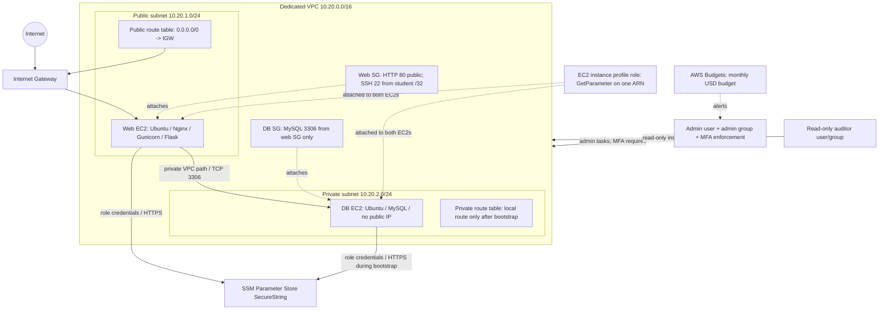

# Architecture and component inventory

## Diagram

The diagram shows the final network state. During bootstrap only, a public NAT Gateway and a default route from the private route table are created. The compute script does not remove them until `http://WEB_PUBLIC_IP/db` returns a database-connected response; it then removes the private default route, deletes the NAT Gateway and releases the NAT's Elastic IP.

## Component summary

| Component | Purpose | Security boundary / proof |
|---|---|---|
| VPC `10.20.0.0/16` | Isolated network for this lab | Dedicated VPC ID stored in local ignored state |
| Public subnet `10.20.1.0/24` | Hosts the web server with a public IPv4 address | Public route table points to IGW |
| Private subnet `10.20.2.0/24` | Hosts MySQL with no public IPv4 address | No permanent `0.0.0.0/0` route after bootstrap |
| Web security group | Allows public HTTP and restricted SSH | Port 80 from `0.0.0.0/0`; port 22 from one `/32` |
| Database security group | Allows MySQL from web tier only | TCP 3306 source is the web security group ID |
| Instance profile and role | Provides short-lived workload credentials | Role policy grants only `ssm:GetParameter` on one parameter ARN |
| SSM Parameter Store | Stores DB password as encrypted `SecureString` | Parameter name visible; secret value never committed or logged |
| Gunicorn | Runs Flask application on a Unix socket | Service runs as `webstack`, socket group `www-data` |
| Nginx | Public HTTP reverse proxy | Only listens on port 80 in this lab; TLS is not configured |
| AWS Budgets | Alerts on actual/forecasted account spend | 80% actual + 100% forecasted email notifications |
| IAM admin group | Human administrative identity | `AdministratorAccess` plus no-MFA deny guardrail |
| IAM auditor group | Read-only human identity | AWS managed `ReadOnlyAccess` policy |

## Application behavior

- `GET /` returns basic service metadata.
- `GET /health` checks the web process, not the database.
- `GET /db` opens a connection using environment variables, executes `SELECT 1`, closes the connection, and returns 200 only if the DB query succeeds. This is the readiness gate used before deleting the temporary NAT Gateway.

The Flask app reads `DB_HOST`, `DB_PORT`, `DB_USER`, `DB_PASSWORD` and `DB_NAME` from `/etc/webstack/webstack.env`. It does not embed database credentials in Python source.

## Trade-offs and non-goals

- Single AZ and one `t3.micro` tier are for learning only, not production availability or capacity.
- HTTP-only port 80 is used to satisfy the assignment's “only port 80 open to the world” policy. Add TLS and a domain before production use.
- The workload role is deliberately not an SSM managed-instance role. That preserves the requirement that it can read only one SSM parameter. Consequently, it cannot use Session Manager; use the approved lab access path for debugging.
- A `SecureString` protects the parameter at rest and through the AWS API, but any workload principal allowed to decrypt/read it can use it. The web host needs the secret too to connect to MySQL.
- The sample app only needs SELECT for its health check. Real applications need a reviewed set of additional SQL privileges.
